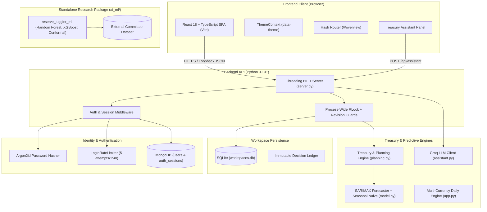

# Reserve Juggler

**Predict cash needs, protect upcoming payments, and invest eligible surplus.**

Reserve Juggler is an institutional treasury liquidity and investment decision-support system designed to solve **The Idle Cash Problem** in high-velocity banking and corporate treasury operations. It bridges the gap between static cash buffers and aggressive yield-seeking by continuously balancing liquidity protection against investment opportunities.

<<<<<<< HEAD
By reconciling historical cashflow observations, SARIMAX-fitted and seasonal-naive predictive flows, chronological payment obligations, uncertainty buffers, and term-deposit lock horizons, Reserve Juggler calculates exactly how much cash must remain liquid to protect payouts and identifies the precise eligible surplus available for yield optimization.

> **Important Operational Context:**  
> All balances, investments, payment events, and execution outcomes inside the interactive hourly dashboard are **simulated in sandbox environments**. Connecting data or running scenarios does not connect live bank payment rails or execute real-world money movements.
=======
The repository contains three primary components:

| Component | Purpose | Entry point |
| --- | --- | --- |
| INR hourly treasury dashboard | Modern React 18 SPA with time-aware cash protection, maturity-aware investments, event simulation, AI assistant, and explainable decisions | `server.py` and `web/` |
| Multi-currency daily engine | Daily forecasting, balance projection, EUR-normalized funding allocation, backtesting, and Excel reporting | `app.py` or `main.py` |
| Standalone AI/ML package | Causal feature engineering, Random Forest / XGBoost models, conformal interval calibration, path-risk scenarios, and shadow diagnostic integration | `ai_ml/` (`reserve_juggler_ml`) |
>>>>>>> origin/AIML

---

## Table of Contents

- [1. Executive Summary & Problem Statement](#1-executive-summary--problem-statement)
- [2. How Reserve Juggler Works](#2-how-reserve-juggler-works)
- [3. Verified MVP Features & Implementation Status](#3-verified-mvp-features--implementation-status)
- [4. End-to-End User Journey](#4-end-to-end-user-journey)
- [5. Unique Value Proposition & Comparison](#5-unique-value-proposition--comparison)
- [6. System Architecture](#6-system-architecture)
- [7. Technology Stack](#7-technology-stack)
- [8. Repository Structure](#8-repository-structure)
- [9. Prerequisites & System Requirements](#9-prerequisites--system-requirements)
- [10. Installation & Configuration](#10-installation--configuration)
- [11. Running the Applications](#11-running-the-applications)
- [12. Testing & Verification](#12-testing--verification)
- [13. Special Report: AI/ML Module Integration Status](#13-special-report--aiml-module-integration-status)
- [14. Multi-Currency Daily Allocation Engine](#14-multi-currency-daily-allocation-engine)
- [15. User Interface & Screen Previews](#15-user-interface--screen-previews)
- [16. Security, Authentication & Data Handling](#16-security-authentication--data-handling)
- [17. Current Limitations](#17-current-limitations)
- [18. Planned Future Improvements](#18-planned-future-improvements)
- [19. License](#19-license)

---

<<<<<<< HEAD
## 1. Executive Summary & Problem Statement

### The Problem in Treasury Operations
Modern banking and fintech platforms process massive daily transaction flows across payment gateways, merchant settlements, and domestic clearing systems (e.g., UPI, IMPS, NEFT, RTGS). 

In traditional operations, treasury teams face an acute dilemma:
1. **The Idle Cash Trap:** Leaving large cash reserves in zero-interest settlement or operational accounts protects payouts but forfeits substantial annual yield.
2. **The Liquidity Shortfall Trap:** Manually moving excess cash into locked term deposits without chronological visibility leads to disastrous timing mismatches—where high-priority payroll or RTGS transfers fail because cash is locked for another 12 hours.
3. **The Static Buffer Fallacy:** Maintaining a fixed safety threshold (e.g., ₹85 million) fails to adapt to predictable intraday volatility, festival spikes, or merchant settlement delays.

### Core Distinctions
A foundational principle of Reserve Juggler is distinguishing transaction volume from investable liquidity:
- **Gross Transaction Movement (Throughput):** High-velocity volume moving through rails (e.g., ₹2 crore/hour illustrative flow) is **not** liquid cash.
- **Cash Balance:** The actual liquid funds held at a specific instant.
- **Protected Reserve:** The capital strictly required to absorb projected net drawdowns, timed payouts, and forecast uncertainty through a specific investment horizon.
- **Eligible Surplus:** The residual cash that can safely be committed to a lock period without endangering any scheduled obligation.
=======
The current application consists of a Python backend and a React 18 TypeScript frontend built with Vite.

### Prerequisites

- **Python 3.12+** with a virtual environment (`.venv` or `.venv-win`)
- **Node.js 18+** for the frontend build
- **MongoDB** (optional, running on `mongodb://127.0.0.1:27017` for banker authentication; falls back to in-memory/SQLite if unavailable)
- **Groq API Key** (optional, set `GROQ_API_KEY` in `.env` for the Ask Treasury Assistant panel)

### 1. Build the Frontend

From the repository root:
>>>>>>> origin/AIML

### Illustrative Baseline Assumptions
Within the demonstration sandbox, the system operates under realistic banking parameters:
- **Gross Throughput:** Scaled around ₹20,000,000 (₹2 crore) gross flow per hour.
- **Illustrative Annual Yields:** 4.0% (6-hour lock), 5.0% (24-hour lock), and 5.4% (48-hour lock).
- **Early Withdrawal:** Contractually disabled. Funds committed to term tranches cannot be liquidated until contractual maturity.
- **Chronological Priority:** Outflows are evaluated chronologically before inflows occurring at the same timestamp. A settlement arriving at 15:00 cannot fund an obligation due at 14:00.

---

## 2. How Reserve Juggler Works

Reserve Juggler executes a rigorous chronological liquidity pipeline:

```
Historical Hourly Cashflows + Scheduled Obligations
                        │
                        ▼
      SARIMAX / Seasonal-Naive Forecasting
      (72h Multi-Horizon Net Flow & Prediction Intervals)
                        │
                        ▼
      Chronological Cash Path Reconstruction
      (Intrahour Outflow Priority & Milestone Sequencing)
                        │
                        ▼
      Root-Sum-Square Uncertainty Accumulation
      + Policy Minimum Operational Floor
                        │
                        ▼
      Mathematical Reserve & Surplus Derivation
      Floor = Minimum Buffer + Additional Risk Buffer
      Required Reserve = Floor + Worst Projected Drawdown
      Eligible Principal = max(0, Liquid Cash - Reserve - Fee)
                        │
                        ▼
      Term Product Optimization (6h vs 24h vs 48h)
      (Evaluates Minimum Principal, Fees, Yields, Drawdowns)
                        │
                        ▼
      Simulated Execution, Idempotency & Revision Guards
      (Transactional State Update + Immutable Audit Ledger)
                        │
                        ▼
      Contractual Maturation & Yield Accrual
```

### Mathematical Reserve Calculation
For every candidate placement with lock horizon $H$:
1. **Protected Floor:**
   $$\text{Floor} = \text{Minimum Operational Buffer} + \text{Additional Risk Buffer}$$
2. **Cumulative Drawdown at Step $h \le H$:**
   $$\Delta \text{Cash}_h = \sum_{t=1}^h (\text{Deposits}_t - \text{Withdrawals}_t - \text{Scheduled Payouts}_t + \text{Maturities}_t)$$
3. **Uncertainty Allowance:**
   $$\text{Uncertainty}_h = \sqrt{\sum_{t=1}^h (\text{Forecast Mean}_t - \text{Lower Bound}_t)^2}$$
4. **Required Reserve:**
   $$\text{Reserve}_H = \text{Floor} + \max_{1 \le h \le H} \max(0, -(\Delta \text{Cash}_h - \text{Uncertainty}_h))$$
5. **Eligible Principal:**
   $$\text{Eligible} = \max(0, \lfloor \text{Liquid Cash} - \text{Reserve}_H - \text{Entry Fee} \rfloor)$$

If eligible principal satisfies the product's minimum ticket size and produces positive net interest after entry fees, it is presented as a recommended placement.

---

## 3. Verified MVP Features & Implementation Status

Every feature in the repository has been audited and classified according to the project's evidence standard:

| Feature Area | Description & User Capability | Data Mode | Implementation Status |
| :--- | :--- | :--- | :--- |
| **Banker Authentication** | Self-service registration, Argon2id hashing, secure cookies, in-memory rate limiting (5 attempts/15 min), and session revocation. | Persisted (MongoDB) | **Implemented** |
| **Workspace Overview** | High-level KPI cards (Liquid Cash, Required Reserve, Eligible Surplus, Locked Vault), recommended investment card, and before/after cashflow timeline. | Persisted Sandbox (SQLite) | **Implemented** |
| **Cashflow Forecasting** | 72-hour hourly forecasts using SARIMAX (with seasonal-naive fallback), dual independent gross decomposition (UPI, IMPS, NEFT, RTGS, ATM), and prediction intervals. | Persisted & Computed | **Implemented** |
| **Multi-Term Investment Optimizer** | Comparison across 6h Intraday, 24h Overnight, and 48h Extended deposits; automated fee and yield deduction; single-term net yield maximization. | Simulated Sandbox | **Implemented** |
| **Controlled Execution Simulation** | Review modal with options to simulate realistic execution outcomes: Success, Infrastructure Failure, or Timeout before settlement. | Simulated Sandbox | **Implemented** |
| **Scenario Lab & Stress Testing** | Interactive simulation of withdrawal spikes, merchant settlement delays, festive surges, and payday outflows without mutating saved state. | Simulated Sandbox | **Implemented** |
| **Historical Strategy Replay** | 24-hour chronological backtest comparing Fixed Buffer (A), Legacy Forecast (B), and Reserve Juggler (C) with MAE/RMSE metrics. | Simulated Sandbox | **Implemented** |
| **Events & Obligations Manager** | Interactive injection of ad-hoc withdrawals, vendor payouts, incoming deposits, settlement receipts, delays, or emergency risk buffers. | Persisted Sandbox (SQLite) | **Implemented** |
| **Audit Ledger & Decision History** | Immutable, chronological record of every reserve assessment, balance shift, simulation outcome, fee charge, and explanation rationale. | Persisted Sandbox (SQLite) | **Implemented** |
| **Sweep Activity & Maturity Tracking** | Real-time tracking of active locked tranches, contracted maturity timestamps, and automated principal/interest return to liquid cash. | Persisted Sandbox (SQLite) | **Implemented** |
| **Reserve Policy Configuration** | User-controlled toggles for automated sweeping, minimum operational buffer, custom interest rates, and confidence intervals. | Persisted Sandbox (SQLite) | **Implemented** |
| **Hourly CSV Data Import** | Validation and ingestion of 168–5,000 consecutive hourly rows with monotonic timestamp validation, duplicate checks, and sample CSV download. | User Upload / Sample | **Implemented** |
| **AI Treasury Assistant** | Floating chat panel powered by Groq API (`Llama-3.3-70b-versatile` / `gpt-oss-120b`) with bounded, read-only session context and local rule-based fallback. | Live API / Local Fallback | **Implemented** |
| **Authoritative Theme System** | Zero-flash Light/Dark switching with semantic CSS design tokens, WCAG-compliant contrast, and persistent `localStorage` synchronization. | Browser State | **Implemented** |
| **Multi-Currency Daily Engine** | Cross-currency daily liquidity allocation (EUR base, USD, JPY, BRL, INR, AUD) using SciPy linear programming in Streamlit. | Standalone Demo | **Implemented** |
| **Advanced ML Package (`ai_ml/`)** | Standalone Python package (`reserve_juggler_ml`) containing causal feature engineering, Random Forest, XGBoost, conformal calibration, and path deficits. | Offline Research / External Dataset | **Experimental / Standalone** |

---

## 4. End-to-End User Journey

```
[Public Landing Page] ──► [Banker Register / Login] ──► [Protected Treasury Workspace]
                                                                  │
      ┌───────────────────────────────────────────────────────────┴───────────────────────────────────────────┐
      ▼                                                           ▼                                           ▼
[1. Overview & Decision Card]                             [2. Forecast Horizon]                       [3. Scenario Lab]
Review liquid cash, required reserve,                      Inspect 72h net & gross projections,        Simulate payday spikes, delays,
and the top recommended placement                          confidence bounds, and baseline MAE         and run 24h strategy replays
      │                                                           │                                           │
      ▼                                                           ▼                                           ▼
[4. Investment Optimization]                              [5. Events & Obligations]                   [6. Audit Ledger & Activity]
Compare 6h, 24h, and 48h locks;                           Inject timed payments, delays, or           Inspect timestamped decisions,
simulate success, failure, or timeout                     risk alerts affecting reserve needs         locked tranches, and sweeps
```

### 1. Landing Page (`/#home`, `/#method`)
- **Purpose:** Public introduction to Reserve Juggler's core value proposition, methodology, and live architectural breakdown.
- **User Actions:** Explore interactive statistics, view the operational timeline, switch themes, or launch the workspace.

### 2. Banker Authentication (`/#login`, `/#register`)
- **Purpose:** Secure workspace entry point.
- **User Actions:** Create an institutional banker account (Name, Organization, Email, Title, Password) or sign in.
- **State Change:** Authenticates via Argon2id, issues a secure HttpOnly session cookie (`rj_auth`), and sets a CSRF token.

### 3. Treasury Overview (`/#overview`)
- **Purpose:** Primary command center displaying real-time operational liquidity.
- **Displayed Information:** Liquid Cash, Protected Reserve, Eligible Surplus, Locked Vault, Expected Interest, and the interactive **Before vs After Timeline**.
- **User Actions:** Review the primary decision card, launch an allocation review, or advance the simulated hour.

### 4. Cashflow Forecasts (`/#forecast`)
- **Purpose:** Predictive intelligence inspecting cash movement over 1h, 6h, 24h, 48h, and 72h horizons.
- **Displayed Information:** SARIMAX model status, net cashflow curves with upper/lower uncertainty bounds, baseline MAE error score, and independent channel decompositions (UPI, IMPS, NEFT, RTGS, ATM).
- **User Actions:** Toggle time horizons, switch between net and gross breakdowns, and inspect hourly data tables.

### 5. Investment Options & Optimizer (`/#investments`)
- **Purpose:** Term comparison and yield selection.
- **Displayed Information:** Available placements (6h Intraday, 24h Overnight, 48h Extended), contractual lock terms, minimum tickets, entry fees, and expected net returns.
- **User Actions:** Override illustrative yield rates, adjust additional risk buffers, and trigger the "Review optimized sweep" modal.

### 6. Events & Liquidity Shocks (`/#events`)
- **Purpose:** Real-time event simulation.
- **User Actions:** Add upcoming obligations (vendor payouts, payroll), incoming receipts, delay pending merchant settlements by $N$ hours, or trigger emergency risk buffers.
- **Output:** Immediately recalculates required reserves across all horizons and updates investment eligibility.

### 7. Scenario Lab & Stress Testing (`/#scenarios`)
- **Purpose:** Non-destructive hypothetical stress analysis.
- **User Actions:** Apply predefined presets (UPI Outflow Spike, Payday Crunch, Festival Surge, Settlement Gridlock) or custom stress parameters.
- **Output:** Renders a side-by-side comparison of baseline vs. stressed reserves and runs a 24-hour chronological strategy backtest.

### 8. Audit Ledger & Sweep Activity (`/#decisions`, `/#activity`)
- **Purpose:** Full transparency and compliance tracking.
- **Displayed Information:** Timestamped records of every investment, balance shift, simulation outcome, and locked tranche maturation schedule.
- **User Actions:** Open any ledger entry to inspect the mathematical breakdown, policy state, and explanation rationale.

### 9. Reserve Policy & Data Management (`/#policy`, `/#data`)
- **Purpose:** Governance and observation ingestion.
- **User Actions:** Toggle autonomous hourly sweeping, adjust minimum liquidity floors, download the sample CSV, or import custom 168–5,000 hour cashflow datasets.

### 10. Ask Treasury Assistant (Floating Panel)
- **Purpose:** Natural-language explainability and guidance.
- **User Actions:** Inquire why a sweep was blocked, how reserves were derived, or what obligations are due.
- **Mechanism:** Integrates Groq LLM API with bounded, read-only session state snapshots.

---

## 5. Unique Value Proposition & Comparison

Reserve Juggler provides unified, chronological decision support that adapts to intraday volatility:

| Approach | Traditional Limitation | Reserve Juggler Capability |
| :--- | :--- | :--- |
| **Static Fixed Buffer** | Leaves excess funds idle during low-activity windows; fails to absorb concentrated payday surges. | **Dynamic Time-Aware Reserve:** Continuously recalculates required capital based on forecasted obligations and uncertainty accumulation. |
| **Yield-First Allocation** | Commits maximum funds to the highest-yielding long-term lock, causing overdrafts when near-term payments fall due. | **Horizon-Constrained Eligibility:** Excludes funds needed to satisfy payouts within candidate lock windows before declaring eligible surplus. |
| **Fragmented Manual Spreadsheets** | Data siloed between accounting systems, payment queues, and bank portals leads to slow, error-prone decisions. | **Integrated Treasury Workspace:** Unifies real-time forecasts, scheduled obligations, execution safeguards, and audit ledgers in one interface. |
| **Decisions Without Stress Testing** | Assumes normal conditions; vulnerable to sudden clearing delays or unexpected payment surges. | **Scenario Lab:** Non-destructive stress simulation enables treasury managers to evaluate worst-case drawdowns before committing capital. |

*Disclaimer: Forecasts and scenarios provide operational decision support; they do not eliminate liquidity risk or provide an unconditional guarantee against market disruptions.*

---

## 6. System Architecture

Reserve Juggler consists of a React 18 single-page application served by an asynchronous Python backend, supported by MongoDB for banker identity and SQLite for local workspace state:



---

## 7. Technology Stack

### Frontend Application (`web/`)
- **Core Framework:** React 18.3.1
- **Language:** TypeScript 5.6.3
- **Build Tooling & Dev Server:** Vite 6.0.1
- **Styling Architecture:** Pure Vanilla CSS, Modern CSS Custom Properties (Semantic Design Token system), Glassmorphism, Zero-FOUC theme engine.
- **Animations:** Motion 14.3.0 & Hardware-accelerated CSS Shaders (Zero-WebGL SpecularButton).
- **Icons & Visuals:** Custom scalable SVG system.

### Backend & API Services (`server.py`, `liquidity_forecasting/`)
- **Runtime Environment:** Python 3.10+ (tested against Python 3.13)
- **HTTP Server:** Python Standard Library `http.server.ThreadingHTTPServer` (Zero external framework overhead, bounded loopback bindings).
- **Authentication & Cryptography:** `argon2-cffi` (Argon2id hashing), `secrets` module, SHA-256 session token hashing.
- **Database Drivers:** `pymongo` 4.15+ (MongoDB Atlas or local daemon).
- **State Persistence:** Python Standard Library `sqlite3` with transactional locks.
- **Forecasting & Econometrics:** `statsmodels` (SARIMAX), `scipy` (Linear Programming), `pandas`, `numpy`.
- **LLM Integration:** Groq Cloud Chat Completions API via standard library `urllib.request`.

### Standalone Machine Learning Package (`ai_ml/`)
- **Package Name:** `reserve_juggler_ml` (configured via `pyproject.toml`)
- **ML Frameworks:** `scikit-learn` (RandomForestForecaster), `xgboost` (XGBoostForecaster).
- **Evaluation & Validation:** Conformal prediction intervals, non-parametric quantile estimators, chronological rolling-origin evaluation.

---

## 8. Repository Structure

```text
Reserve-Juggler-2.0/
├── server.py                     # Main HTTP API server, routing, static build serving
├── start.ps1                     # PowerShell background/foreground process launcher
├── app.py                        # Standalone daily multi-currency Streamlit application
├── main.py                       # Standalone daily batch allocation demonstration
├── pyproject.toml                # Project configuration, test paths, Ruff lint rules
├── requirements.txt              # Core runtime dependencies
├── requirements-dev.txt          # Development, testing, and linting tools
├── .env.example                  # Environment configuration template
│
├── liquidity_forecasting/        # Core treasury intelligence backend package
│   ├── auth.py                   # Banker identity, MongoDB sessions, Argon2id, rate limiting
│   ├── planning.py               # Chronological cash path, reserve derivation, optimization
│   ├── treasury.py               # State transitions, simulation settlement, balance mutators
│   ├── model.py                  # SARIMAX forecaster with seasonal-naive fallback
│   ├── assistant.py              # Groq LLM integration and bounded context builder
│   ├── strategy_evaluation.py    # A/B/C strategy comparison engine & historical backtest
│   ├── allocation.py             # Linear programming funding optimizer for daily multi-currency
│   ├── balances.py / fx.py       # Multi-currency projection and EUR FX normalization
│   └── data.py / validation.py   # Daily data generation and CSV schema validators
│
├── web/                          # Production React 18 TypeScript frontend
│   ├── index.html                # Single-page entry point with early theme injection
│   ├── package.json              # Frontend dependencies and Vite build scripts
│   ├── styles.css                # Global design system, semantic tokens, and landing styles
│   ├── src/
│   │   ├── main.tsx              # React mounting root
│   │   ├── App.tsx               # Primary layout router, auth guards, modal orchestrator
│   │   ├── workspace.css         # Operational workspace stylesheet
│   │   ├── visuals.css           # UI visual polish and micro-animations
│   │   ├── components/
│   │   │   ├── layout/           # Shell, Sidebar, Topbar, Brand navigation
│   │   │   ├── common/           # SpecularButton, StarBorder, CurvedLoop, Badges, Toasts
│   │   │   ├── pages/            # Overview, Forecast, Investments, Scenarios, Events, etc.
│   │   │   ├── modals/           # InvestModal, SweepModal, ResetModal, LedgerDetailModal
│   │   │   └── charts/           # NetFlowChart, GrossFlowChart, HorizonCharts
│   │   ├── context/              # AuthContext, ThemeContext, TreasuryContext
│   │   ├── hooks/                # useAuth, useTreasury, useHashRoute
│   │   └── types/                # TypeScript treasury state, user, and API contracts
│   └── dist/                     # Compiled production bundle served by server.py
│
├── ai_ml/                        # Standalone AI/ML research package (reserve_juggler_ml)
│   ├── pyproject.toml            # Independent package build definition
│   ├── README.md                 # AI/ML module purpose and execution guide
│   ├── docs/                     # Research audits, model comparison plans, integration contracts
│   ├── src/reserve_juggler_ml/   # Causal features, forecasters, conformal calibration
│   ├── tests/                    # Independent ML unit and contract tests (64 tests)
│   └── scripts/                  # Multi-phase model evaluation runners
│
├── tests/                        # Full backend unit, integration, and HTTP test suite (170 tests)
│   ├── test_assistant.py         # Assistant isolation, context truncation, API checks
│   ├── test_auth.py              # Argon2id, session TTL, rate limiting, MongoDB mocking
│   ├── test_integrated_treasury.py # State machine, revision checks, idempotency, execution
│   ├── test_planning.py          # Chronological reserve calculations, intrahour priority
│   ├── test_server.py            # End-to-end loopback HTTP endpoints and CSP checks
│   └── test_treasury.py          # Sweep math, tranche maturity, auto-sweep automation
│
└── .runtime/                     # Local SQLite state (workspaces.db), logs, runtime artifacts
```

---

## 9. Prerequisites & System Requirements

Before setting up Reserve Juggler, verify that your environment satisfies:

- **Operating System:** Windows 10/11, macOS 12+, or modern Linux (Ubuntu 22.04+ recommended).
- **Node.js:** v18.0.0 or higher (v20+ recommended) with `npm` v9+.
- **Python:** Version 3.10, 3.11, 3.12, or 3.13.
- **Database:** MongoDB Community Server v6.0+ (running locally at `mongodb://127.0.0.1:27017` or accessible via MongoDB Atlas URI).
- **Optional API Key:** Groq Cloud API key (for live LLM conversational answers in the Treasury Assistant).

---

## 10. Installation & Configuration

### Step 1: Clone the Repository
```bash
git clone https://github.com/Ashutoshr2207/Reserve-Juggler-2.0.git
cd Reserve-Juggler-2.0
```

### Step 2: Configure Environment Variables
Copy `.env.example` to create your local `.env`:
```powershell
# Windows PowerShell
Copy-Item .env.example .env

# macOS / Linux
cp .env.example .env
```

Review `.env` and configure your settings:
```ini
# MongoDB connection settings
MONGODB_URI=mongodb://127.0.0.1:27017
MONGODB_DB_NAME=reserve_juggler

# Application environment
APP_ENV=development
SECURE_COOKIES=false

# Session lifetime (default: 30 days in seconds)
AUTH_SESSION_LIFETIME_SECONDS=2592000

# Optional: Groq API Key for Treasury Assistant
GROQ_API_KEY=your_groq_api_key_here
GROQ_MODEL=openai/gpt-oss-120b
TREASURY_ASSISTANT_TIMEOUT=30
```

### Step 3: Install & Build the Frontend
The Python server directly serves the compiled React application from `web/dist`:
```bash
cd web
npm install
npm run build
cd ..
```
*(The build outputs optimized HTML, CSS, and JS into `web/dist` in approximately 1.2 seconds.)*

### Step 4: Set Up the Python Environment

#### Windows (PowerShell)
```powershell
<<<<<<< HEAD
python -m venv .venv-win
.\.venv-win\Scripts\python.exe -m pip install --upgrade pip
.\.venv-win\Scripts\pip install -r requirements.txt -r requirements-dev.txt
```

#### macOS / Linux
```bash
python3 -m venv .venv
source .venv/bin/activate
pip install --upgrade pip
pip install -r requirements.txt -r requirements-dev.txt
```

---

## 11. Running the Applications

### Option A: Standard Web Workspace (Recommended)

#### Using the Windows Launcher:
```powershell
.\start.ps1 -Foreground
```

#### Using Direct Python Command:
```powershell
# Windows
.\.venv-win\Scripts\python.exe server.py --port 8000

# macOS / Linux
python server.py --port 8000
```

Open your browser and navigate to: **`http://127.0.0.1:8000`**

- The application will load the **Public Landing Page**.
- Click **"Sign In"** or **"Enter Workspace"**.
- If logging in for the first time, click **"Create Account"** (`/#register`) to create your banker profile. Your account and session will be stored securely in MongoDB.
=======
cd web
npm ci
npm run build
cd ..
```

The production bundle is compiled into `web/dist` and served directly by Python.

### 2. Configure Environment

Copy `.env.example` to `.env` (which is ignored by Git) to configure optional services:

```ini
GROQ_API_KEY=your_groq_api_key
GROQ_MODEL=openai/gpt-oss-120b
TREASURY_ASSISTANT_TIMEOUT=30
MONGODB_URI=mongodb://127.0.0.1:27017
MONGODB_DB_NAME=reserve_juggler
RJ_ML_SHADOW_ENABLED=false
```

### 3. Launch the Application

#### Windows

From the repository root:

```powershell
python -m venv .venv
.\.venv\Scripts\python.exe -m pip install -r requirements.txt -r requirements-dev.txt
# Optional editable installation of the AI/ML research package:
.\.venv\Scripts\python.exe -m pip install -e ai_ml
.\start.ps1
```

Open [http://127.0.0.1:8000/#home](http://127.0.0.1:8000/#home) to explore the public landing page, or sign in at `#login` to access the protected workspace at `#overview`.

For foreground execution or another port:

```powershell
.\start.ps1 -Foreground
.\start.ps1 -Port 8019
# Direct execution:
.\.venv\Scripts\python.exe server.py --port 8000
```

#### macOS or Linux

```bash
python3 -m venv .venv
source .venv/bin/activate
pip install -r requirements.txt -r requirements-dev.txt
pip install -e ai_ml
python server.py --port 8000
```

## Treasury workflow

```text
Historical hourly observations + scheduled events
                      ↓
        SARIMAX / seasonal-naive forecast
                      ↓
   Chronological cash path + uncertainty + stress
                      ↓
     Required reserve and eligible principal
                      ↓
       Compare 6h / 24h / 48h investments
                      ↓
   Revalidate → simulate execution → verify balances
                      ↓
       Decision ledger → maturity → recalculate
```

A deposit arriving later cannot fund an earlier payment. Payments, deposits, merchant receipts, and contractual maturities are evaluated in timestamp order, with outflows before receipts at identical timestamps.

For example, a ₹7 million payout at 14:00 must be protected before a ₹4 million settlement arriving at 15:00 is considered. Tests cover this sequencing and intrahour maturities: identical end-of-hour balances can conceal an earlier funding gap.

New events immediately recalculate recommendations. Supported events include withdrawals, payments, deposits, merchant settlements, settlement delays, and risk alerts that change the additional risk buffer. Advancing the sandbox clock realizes a simulated hour, processes due events and maturities, and reevaluates automatic sweeping. This is event-driven simulation, not live payment processing.

## Forecasting and reserve calculations

### Forecasts

- The existing net-flow pipeline fits SARIMAX to up to 28 days of hourly observations and forecasts the next 72 hours using a 24-hour seasonal cycle.
- Fitting failure or nonconvergence uses the existing seasonal-naive fallback and labels the model accordingly.
- Independent seasonal-naive forecasts estimate deposits and withdrawals separately. Their means are displayed in the forecast table; their intervals are returned by the API.
- The authoritative net forecast is reconciled into the planner's gross hourly profile. Independent gross estimates can differ from the net forecast and are not presented as separate SARIMAX predictions.
- The dashboard offers 1h, 6h, 24h, 48h, and 72h views, timestamps in IST, model status, uncertainty, and a previous-day baseline MAE. That baseline MAE is not an accuracy score for the currently fitted SARIMAX forecast.

The illustrative gross profile divides withdrawals into UPI 45%, IMPS 20%, NEFT 20%, RTGS 10%, and ATM 5%. It reclassifies 8% of deposits as merchant settlements rather than adding extra receipts. These proportions are demo assumptions, not classifications inferred from bank transaction data.

### Protected reserve

For each proposed investment, the engine checks every relevant cash-flow point during its lock period:

```text
Protected floor = minimum operational cash + additional risk buffer
Required reserve = protected floor + worst projected lock-period drawdown
Eligible principal = max(0, liquid cash − required reserve − entry fee)
Interest = principal × annual rate / 100 × locked hours / (365 × 24)
Net return = interest − entry fee
```

Principal is rounded down to cents. Minimum investment sizes, fees, net returns, timed obligations, delayed settlements, and existing maturities constrain eligibility. Locked principal is excluded from current liquid cash; it enters the future cash path only at contractual maturity. A full 72-hour baseline check also blocks investments when modeled later funding gaps or fees make the path unsafe.

The integrated planner accumulates uncertainty using a root-sum-square allowance:

```text
Allowance through hour h = sqrt(sum((forecast mean − lower bound)² through h))
```

This is a planning heuristic under an **uncorrelated-error assumption**, not a calibrated confidence interval for an entire cash path. Correlated errors and unmodeled peaks can invalidate the modeled protection. Buffers, stress scenarios, and explicitly reported funding gaps remain necessary; there is no unconditional payout guarantee.

The original net-only reserve utility retains its accumulated lower-bound calculation for compatibility and the historical Strategy B benchmark. The legacy custom-term sweep is additionally capped by the integrated timed cash path before execution. The forecast chart shows net-flow balances; the Overview timeline includes scheduled obligations and maturities.

## Investment options and execution

| Demo product | Lock | Illustrative annual rate | Minimum principal | Entry fee |
| --- | ---: | ---: | ---: | ---: |
| Intraday placement | 6 hours | 4.0% | ₹250,000 | ₹20 |
| Overnight deposit | 24 hours | 5.0% | ₹500,000 | ₹50 |
| Extended deposit | 48 hours | 5.4% | ₹1,000,000 | ₹100 |

Rates are configurable illustrations, not market quotes or guaranteed returns. Early redemption is unavailable. Each new product placement records principal, contracted yield, start, maturity, fee, expected interest, and redemption restrictions.

Manual product selection remains available. The optimizer compares eligible options and chooses the greatest net interest **for a single placement at its actual term**. It is not a global multi-period portfolio optimizer or an equal-horizon comparison. Automatic sweeps use this optimizer after each simulated hour when enabled and eligible.

Execution safeguards include:

- Recalculation against current state before a transfer, under the server's process-wide lock.
- Revision checks to reject stale updates and transactional state copies to prevent partial mutations.
- Optional persisted `request_id` fingerprints: an exact retry returns current state without another investment; reuse with a different action or payload is rejected.
- Simulated success, failure, or timeout-before-execution. Failures and timeouts create audit records without moving money or creating tranches.
- Reconciliation that rejects locked principal exceeding the vault balance.
- Contracted principal and interest release at maturity; funding gaps halt automatic sweeping.

The timeout simulation means that no execution occurred. An unknown outcome from a real provider would need provider-side idempotency and reconciliation, which are outside this application.

## Dashboard and demonstration

| View | What to inspect |
| --- | --- |
| Overview | Liquid cash, required reserve, eligible surplus, locked principal, projected minimum, expected return, and risk status |
| Cashflow forecast | Net and independent gross forecasts, short and long horizons, model status, intervals, and baseline error |
| Investment options | Term constraints, fees, returns, manually selected option, and best-return option |
| Payments & events | Add obligations or receipts, delay settlements, or set a new risk buffer |
| Scenario Lab | Compare normal operations, withdrawal spikes, payday payouts, festival surges, settlement delays, and execution failures |
| Decision history | Recorded before/after reserve and investment calculations with explanations |
| Sweep activity | Movements, failures, locked tranches, maturity schedule, and credited interest |
| Reserve policy / Data sources | Automation settings, minimum buffer, forecast policy, and validated CSV import |

A short demonstration:

1. Open Overview and compare the cash timeline before and after a proposed sweep. Inspect the protected floor and proposed lock period.
2. Review the optimized sweep. Select execution failure or timeout and verify unchanged balances and a deferred decision. A successful simulation locks the principal and charges its fee.
3. Add a large payout or delay a settlement. Inspect the updated reserve, reduced or blocked investment, and decision history.
4. Run a combined Scenario Lab stress. Compare reserve, minimum cash, surplus, net return, funding need, and risk status. Hypothetical scenarios do not save financial changes.
5. Run the read-only chronological strategy comparison from Scenario Lab.
6. Enable auto-sweep under Reserve policy and advance the clock. Follow the resulting investment through maturity and inspect contracted interest.

## Data contracts

### Hourly INR CSV

```csv
timestamp,deposits,withdrawals
2026-10-01T00:00:00Z,10000000,9800000
2026-10-01T01:00:00Z,10200000,9900000
```

The two example rows illustrate the format; imports require **168–5,000 consecutive hourly records**, at most 1 MB. Columns must appear in that order. Timestamps must be valid, unique, ascending, exactly one hour apart, and include `Z` or an explicit offset such as `+05:30`. Seconds and fractional seconds must be zero. Amounts must be finite, nonnegative, at most ₹1 trillion, and cannot be booleans. Invalid or missing values are rejected rather than silently filled.

Use Data sources to download a complete sample CSV. Import replaces the observation history, preserves simulated balances, rebuilds demo scheduled events, and disables automatic sweeping. Import is blocked while new investment tranches are locked. Labels distinguish synthetic observations, imported observations, and subsequently simulated hours.

### Daily multi-currency data

The daily workflow uses a dated numeric net-cashflow column per currency, with a `DatetimeIndex` internally. Its Streamlit CSV loader reads the first column as dates. The default currencies are EUR, USD, JPY, BRL, INR, and AUD. Unlike the hourly contract, net values can be negative. See `validation.py`, `data.py`, and the Streamlit upload controls for the daily preprocessing and validation behavior.

## API reference

The HTTP server binds to loopback only. It serves the dashboard and uses an HttpOnly, SameSite session cookie to separate SQLite-backed workspaces. It applies loopback host checks, same-origin checks, JSON request validation, and a content-security policy. These local safeguards are not production authentication.

| Method | Endpoint | Purpose |
| --- | --- | --- |
| GET | `/api/health` | Health, simulation mode, and database connectivity status |
| GET | `/api/state` | Balances, forecasts, integrated intelligence, events, ledger, and optional shadow diagnostic |
| GET | `/api/template` | Complete hourly sample CSV template |
| GET | `/api/export` | Net forecast CSV with policy, recommendation, and model fields |
| POST | `/api/auth/register` | Register new banker account with Argon2id password hashing |
| POST | `/api/auth/login` | Authenticate banker credentials and establish session cookie |
| POST | `/api/auth/logout` | Terminate session and clear cookie |
| GET | `/api/auth/session` | Verify active authenticated banker session |
| POST | `/api/assistant` | Ask Treasury Assistant (Groq LLM with read-only workspace context) |
| POST | `/api/planning_optimize` | Revalidate and simulate the best-return eligible product |
| POST | `/api/planning_invest` | Revalidate and simulate the manually selected product |
| POST | `/api/planning_policy` | Selected product, additional risk buffer, and illustrative rates |
| POST | `/api/planning_event` | Add a payment, withdrawal, deposit, settlement, delay, or risk alert |
| POST | `/api/planning_balance` | Configure simulated balances when no new tranches are locked |
| POST | `/api/planning_scenario` | Read-only timed baseline/stress comparison |
| POST | `/api/backtest` | Read-only 24-hour fallback strategy replay of the current history |
| POST | `/api/policy` | Forecast, floor, custom-term, stress, and automation policy |
| POST | `/api/sweep` | Legacy custom-term sweep with the integrated timed liquidity cap |
| POST | `/api/advance` | Advance one simulated hour and settle due events |
| POST | `/api/import` | Validate and import hourly CSV text |
| POST | `/api/scenario` | Legacy net-only forecast/policy scenario |
| POST | `/api/reset` | Reset the session's sandbox |

Mutation requests require the current `revision`. For an optimized execution:

```json
{
  "revision": 0,
  "request_id": "placement-demo-1",
  "execution": "success"
}
```

Send JSON with `Content-Type: application/json` and retain the session cookie. For an exact retry, reuse the entire original payload, including its revision. `execution` can also be `failure` or `timeout`. Read-only scenario and backtest requests do not increment the revision. Invalid requests are rejected without writing a financial decision; accepted execution failures are recorded.

## Measured strategy comparisons

The saved reports use **seed-42 synthetic INR observations**. Every forecast sees only its historical training prefix; all strategies share the same observations and forecast origins.

- **A — Fixed cash buffer:** retain a configured ₹85 million buffer and invest excess.
- **B — Existing forecast reserve:** original net-only reserve with a 24h, 5%, fee-free demo product.
- **C — Improved Reserve Juggler:** timed, uncertainty-aware reserves and optimized term products with their entry fees.

These compare complete policies, not the isolated impact of one model. Each starts with ₹100 million cash and no existing investments. The historical CSV replay contains no separately scheduled external obligations; scenarios and acceptance tests exercise those. All strategies recalculate hourly, so the replay does not isolate intrahour event-update benefits.

### 72-hour seasonal-naive replay

Evaluation window: 15–18 October 2026 UTC.

| Strategy | Net accrued interest | Average idle cash | Below-floor observations | Maximum funding gap |
| --- | ---: | ---: | ---: | ---: |
| A | ₹8,827.99 | ₹81,295,896.27 | 0 | ₹0 |
| B | ₹32,534.59 | ₹20,891,175.46 | 34 | ₹5,194,766.73 |
| C | ₹31,669.04 | ₹27,547,962.00 | 0 | ₹0 |

Common one-hour net-flow MAE: **₹229,543.66**; RMSE: **₹267,138.54**. C charged ₹1,490 in fees. B earned more net income with modeled floor breaches; C did not outperform every strategy on income.

### 24-hour SARIMAX-pipeline replay

Evaluation window: 17–18 October 2026 UTC.

| Strategy | Net accrued interest | Below-floor observations | Entry fees |
| --- | ---: | ---: | ---: |
| A | ₹2,657.13 | 0 | ₹0 |
| B | ₹10,562.97 | 0 | ₹0 |
| C | ₹10,164.56 | 0 | ₹610 |

Common one-hour MAE: **₹176,854.48**; RMSE: **₹229,795.37**. This run does not demonstrate a net-income improvement over B. The SARIMAX pipeline can fall back at individual origins.

With every third eligible attempt failing in the 72-hour fallback replay, C recorded **11 failures, 11 subsequent recoveries, zero below-floor observations, and ₹31,615.53 net accrued interest**. Recovery means a later eligible placement succeeded, not that money was lost and recovered.

Net interest is accrued interest less entry fees and modeled borrowing costs; accrued returns include still-locked positions and differ from credited interest. Financing cost is an illustrative 12% annual rate charged for one hour on each peak hourly floor gap, without injecting borrowed funds into balances. Below-floor observations are not distinct failed payments; total shortfall can count continuing deficits repeatedly. Early-redemption penalties are zero because early exit is disabled.

Full results: [fallback replay](reports/strategy-comparison.json), [SARIMAX-pipeline replay](reports/strategy-comparison-sarimax.json), and [failure replay](reports/strategy-failures.json).

Reproduce from the repository root:
>>>>>>> origin/AIML

### Option B: Frontend Development Mode (Hot-Reloading)
For developing frontend components with Vite hot-module replacement (HMR):
```powershell
# Terminal 1: Run Backend API
.\.venv-win\Scripts\python.exe server.py --port 8000

# Terminal 2: Run Vite Dev Server
cd web
npm run dev
```
Open the Vite URL (typically `http://localhost:5173`). Vite automatically proxies `/api` calls to `http://127.0.0.1:8000`.

<<<<<<< HEAD
### Option C: Multi-Currency Daily Streamlit Application
To launch the daily cross-currency linear programming allocator:
=======
Use `--output path/to/report.json` to keep separate runs; the default output is `.runtime/strategy-comparison.json`.

## Testing and verification

Latest recorded verification, **18 October 2026**:

| Check | Result | Command |
| --- | --- | --- |
| Complete backend test suite | **198 passed, 0 failed in 95.03s** | `pytest tests` |
| Complete AI/ML package test suite | **133 passed, 2 skipped, 0 failed in 11.87s** | `pytest ai_ml/tests` |
| Focused backend shadow availability tests | **28 passed, 0 failed, 2 warnings in 8.12s** | `pytest tests/test_ml_shadow.py` |
| Focused ML contract and adapter tests | **72 passed, 0 failed in 4.76s** | `pytest ai_ml/tests/test_shadow_contract.py ai_ml/tests/test_adapter.py` |
| Frontend TypeScript type check | **Passed (exit code 0)** | `tsc --noEmit` (in `web/`) |
| Frontend production bundle build | **Built in 1.44s (0 errors)** | `npm run build` (in `web/`) |
| Ruff Python linter & formatter | **Passed** | `ruff check .` and `ruff format --check .` |

Coverage includes chronological payout protection, same-time outflow priority, forecast uncertainty, fees, product constraints, maturity interest, locked-principal exclusion, settlement delays, funding gaps, failure/timeout deferral, exact retries, stale revisions, reconciliation, isolated scenarios, training-prefix leakage checks, banker authentication, MongoDB user management, assistant security, ML shadow non-interference, and the original daily multi-currency functionality.

```powershell
.\.venv-win\Scripts\python.exe -m pytest -q
.\.venv-win\Scripts\python.exe -m ruff check .
.\.venv-win\Scripts\python.exe -m ruff format --check .
node --check web/app.js
node --check web/planning.js
```

Some Windows sandbox runs blocked pytest temporary directories or loopback sockets. The final complete suite ran outside those restrictions. If temporary-directory creation fails, use a fresh workspace path such as `--basetemp=.runtime/pytest-new-run`. A loopback permission failure is an environment restriction, not a passed integration check.

See [VERIFICATION.md](VERIFICATION.md) for the verification record and [ALIGNMENT_REPORT.md](ALIGNMENT_REPORT.md) for the audit, acceptance evidence, detailed assumptions, and implementation changes. The test suite was not rerun for this documentation-only README update.

## Multi-currency daily workflow

The original daily engine remains separate from hourly investment execution. It supports:

- SARIMAX forecasts with seasonal-naive fallback and prediction intervals.
- Opening balances, minimum buffers, projected balances, and liquidity shortfalls.
- EUR base-currency normalization with configurable illustrative FX rates.
- SciPy linear-programming allocation under funding, transfer-cost, and priority constraints.
- Rolling chronological forecast evaluation, plotting, and Excel export.

Run its Streamlit dashboard or batch demonstration:

>>>>>>> origin/AIML
```powershell
# Windows
.\.venv-win\Scripts\python.exe -m streamlit run app.py

# macOS / Linux
streamlit run app.py
```

---

## 12. Testing & Verification

The repository contains extensive automated test suites ensuring zero regressions in accounting logic, chronological ordering, security, and cryptographic handling.

### 1. Main Backend Regression Suite
To run all 170 backend unit, acceptance, and HTTP integration tests:
```powershell
# Windows
.\.venv-win\Scripts\pytest -v

# macOS / Linux
pytest -v
```
**Actual Observed Result:**
```text
============================ 170 passed in 48.23s =============================
```
*Coverage includes:*
- `test_auth.py`: Argon2id password hashing, session tokens, TTL index creation, and login rate limiting.
- `test_assistant.py`: Bounded context sanitization, prompt injection defenses, history trimming, and Groq adapter error handling.
- `test_planning.py`: Chronological payout protection, intrahour maturity ordering, same-timestamp outflow priority, and fee deductions.
- `test_integrated_treasury.py`: Process-wide lock concurrency, optimistic revision guards, idempotent retry fingerprints, and transactional rollbacks.
- `test_server.py`: HTTP loopback binding, Content-Security-Policy headers, SameSite cookies, and static file serving.

### 2. Frontend Production Build & TypeScript Verification
```powershell
cd web
npm run build
```
**Actual Observed Result:**
```text
✓ 497 modules transformed.
dist/index.html                     1.25 kB │ gzip:   0.66 kB
dist/assets/index-4am2O6N3.css    107.33 kB │ gzip:  20.47 kB
dist/assets/index-CsNM8KKQ.js     398.53 kB │ gzip: 126.49 kB
✓ built in 1.21s
```

### 3. Backend Code Quality & Linter Checks
```powershell
.\.venv-win\Scripts\ruff check liquidity_forecasting server.py
```
**Actual Observed Result:**
```text
All checks passed!
```

---

## 13. Special Report: AI/ML Module Integration Status

Per technical audit standards, this section transparently documents the exact architectural status of the `ai_ml/` directory.

### Verified Findings
1. **Present as a Standalone Package:**  
   The `ai_ml/` directory houses a separate Python package named `reserve_juggler_ml` defined with its own `pyproject.toml`. It contains clean implementations of causal feature engineering, Deterministic Baseline, Seasonal-Naïve, Random Forest, and XGBoost forecasters, along with conformal prediction intervals and quantile path-deficit estimation.
2. **Tested Independently:**  
   The package has its own dedicated test suite (`ai_ml/tests/`). Running `pytest ai_ml/tests` executes 64 tests:
   - **62 tests pass completely**, validating feature transforms, ML forecasters, calibration intervals, and risk estimators.
   - **2 tests raise `FileNotFoundError`**, specifically expecting the proprietary external dataset `treasury_4tier_dataset.csv`.
3. **External Dataset Requirement:**  
   Under data protection rule OD-02, private committee datasets are never committed to Git. The loader looks for `$env:RESERVE_JUGGLER_DATASET_PATH`.
4. **Backend Calling Status (Important):**  
   **The production runtime (`server.py` and `liquidity_forecasting/`) does NOT import or call `reserve_juggler_ml`.** The live web dashboard's forecasting engine is powered by `liquidity_forecasting.model`, which fits statsmodels SARIMAX with an automatic seasonal-naive fallback.
5. **Architectural Role:**  
   `ai_ml/` represents an **advanced experimental research module** and reference implementation. An integration adapter exists at `reserve_juggler_ml.integration.adapter`, but active HTTP requests are handled by the core `liquidity_forecasting` engine.

To run the standalone ML test suite:
```powershell
.\.venv-win\Scripts\pytest ai_ml/tests
```

---

## 14. Multi-Currency Daily Allocation Engine

In addition to the hourly INR dashboard, the repository includes a standalone daily engine (`app.py`, `main.py`) addressing cross-border multi-currency liquidity:

### Capabilities
- **Currencies Supported:** EUR (default base), USD, JPY, BRL, INR, and AUD.
- **FX Normalization:** Normalizes balances and forecasts to a base currency using configurable exchange rates.
- **Linear Programming Optimization:** Uses `scipy.optimize.linprog` to solve optimal inter-account transfers satisfying minimum buffer constraints while minimizing transaction and conversion friction.
- **Batch Export:** Generates formatted Excel balance reports and matplotlib cashflow visualizations.

To execute the batch report:
```powershell
.\.venv-win\Scripts\python.exe main.py
```

---

## 15. User Interface & Screen Previews

<<<<<<< HEAD
The user interface is engineered for institutional clarity, combining high-contrast typography, deep navy branding, and responsive data visualizations.

```
┌────────────────────────────────────────────────────────────────────────────────────────────────────────┐
│ RESERVE JUGGLER   [Overview] [Forecast] [Investments] [Scenarios] [Events] [Ledger]  [Theme] [Banker]  │
├────────────────────────────────────────────────────────────────────────────────────────────────────────┤
│ LIQUID CASH         PROTECTED RESERVE     ELIGIBLE SURPLUS      LOCKED VAULT       EXPECTED RETURN     │
│ ₹100,000,000.00     ₹72,452,038.19        ₹27,547,961.81        ₹0.00              ₹3,773.70           │
├────────────────────────────────────────────────────────────────────────────────────────────────────────┤
│ SELECTED INVESTMENT RECOMMENDATION                                                                     │
│ Suggested Principal: ₹27,547,961.00  ·  Overnight Deposit (24h lock @ 5.0% annual yield)               │
│ Expected Net Return: ₹3,723.70       ·  Entry Fee: ₹50.00  ·  Matures in 24 hours                      │
│ [ Review Selected Investment ]  [ Compare All 3 Options ]                                              │
├────────────────────────────────────────────────────────────────────────────────────────────────────────┤
│ LIQUIDITY TIMELINE (BEFORE VS AFTER PROPOSED SWEEP)                                                    │
│ [ Cash Buffer Curve ] ─── Modeled Drawdown vs Protected Floor ──────────────────────────────────────── │
└────────────────────────────────────────────────────────────────────────────────────────────────────────┘
=======
```text
Reserve-Juggler-2.0/
├── server.py                     # HTTP server, REST endpoints, static files, SQLite sessions
├── start.ps1                     # Windows background/foreground process launcher
├── app.py                        # Daily multi-currency Streamlit application
├── main.py                       # Daily batch demonstration
├── liquidity_forecasting/        # Authoritative treasury engine
│   ├── treasury.py               # Forecasts, simulated settlement, state mutations, clock
│   ├── planning.py               # Timed cash path, reserve floors, products, explanations
│   ├── strategy_evaluation.py    # Common-data A/B/C chronological replay
│   ├── model.py                  # SARIMAX(1,0,1)x(1,0,1,24) and seasonal-naive fallback
│   ├── auth.py                   # Argon2id password hashing, MongoDB/SQLite banker sessions
│   ├── assistant.py              # Groq LLM Chat Completions client and knowledge provider
│   ├── assistant_knowledge.md    # Curated treasury operational knowledge base
│   ├── ml_shadow.py              # Diagnostic bridge to optional ML package
│   ├── evaluation.py             # Daily rolling forecast evaluation
│   ├── data.py / validation.py   # Daily data generation and validation
│   ├── balances.py / fx.py       # Daily projections and FX normalization
│   ├── allocation.py             # Constrained daily funding allocation
│   └── export.py / plotting.py   # Excel reports and plots
├── ai_ml/                        # Standalone AI/ML research package (reserve_juggler_ml)
│   ├── README.md                 # Package documentation and quick start
│   ├── pyproject.toml            # Build configuration and dependencies
│   ├── src/reserve_juggler_ml/
│   │   ├── data/                 # Causal data loaders & validation schemas
│   │   ├── features/             # 22-dimensional causal feature engineering
│   │   ├── forecasting/          # Random Forest & XGBoost multi-horizon regressors
│   │   ├── uncertainty/          # Lead-time conformal prediction-interval calibration
│   │   ├── liquidity_risk/       # Paired-trajectory scenario path-drawdown calibrator
│   │   ├── evaluation/           # Chronological rolling metrics (MAE, RMSE, MASE, R²)
│   │   └── integration/          # Backend adapter, contract validator & shadow executor
│   ├── tests/                    # 133 unit & contract tests
│   └── docs/                     # Research reports, calibration & shadow integration docs
├── web/                          # Frontend application
│   ├── src/                      # React 18 TypeScript source code
│   │   ├── components/           # Pages, layout (Shell, Sidebar, Topbar), modals, charts
│   │   ├── context/              # AuthContext and TreasuryContext state providers
│   │   ├── hooks/                # useTreasury, useAuth, useHashRoute hooks
│   │   ├── types/                # TypeScript interfaces for auth and treasury state
│   │   ├── utils/                # API client, formatters, download helpers
│   │   └── main.tsx / App.tsx    # Application entry point and router
│   ├── dist/                     # Compiled production bundle (served by server.py)
│   ├── package.json              # Dependencies (Vite, React 18, TypeScript)
│   └── vite.config.ts            # Vite configuration and development proxy
├── tests/                        # 198 backend unit, acceptance, and HTTP integration tests
├── reports/                      # Saved measured synthetic replay results
├── requirements*.txt            # Runtime, development, and locked dependencies
├── ML_INTEGRATION_CONTRACT.md    # Historical ML integration contract specification
├── BACKEND_FRONTEND_INTEGRATION_GAPS.md # Operational deployment gap analysis
├── TREASURY_ASSISTANT.md         # Groq LLM Assistant setup and verification guide
├── ALIGNMENT_REPORT.md           # Current audit, methodology, results, and demo
├── VERIFICATION.md               # Recorded checks and test evidence
└── .runtime/                     # Local SQLite state, logs, and generated artifacts
>>>>>>> origin/AIML
```

### Visual Verification
- **Zero Broken Overlays:** Hardware-accelerated CSS pseudo-elements provide interactive specular highlights with zero canvas context crashes or sad-face browser icons.
- **Authoritative Contrast:** Light mode utilizes crisp white cards with dark slate typography (`#0A192F`); Dark mode utilizes an institutional navy palette (`#0B1220`, `#111C2E`, `#18263B`) with high-contrast text (`#F1F5FB`), strictly avoiding unstyled pure-black surfaces.
- **Documentation Screenshots:** Production UI captures can be saved under `docs/screenshots/` for visual presentation in GitHub showcases.

---

## 16. Security, Authentication & Data Handling

1. **Password Security:** Passwords hashed using industry-standard **Argon2id** (`time_cost=2`, `memory_cost=64MB`, `parallelism=1`).
2. **Session Protection:** Session identifiers are generated using cryptographically secure random bytes (`secrets.token_hex`), and stored in MongoDB as **SHA-256 digests**. Session cookies utilize `HttpOnly`, `SameSite=Lax` (or `Strict`), and configurable `Secure` flags.
3. **Brute-Force Rate Limiting:** In-memory sliding window rate limiter locks accounts for 15 minutes after 5 consecutive failed login attempts.
4. **Optimistic Concurrency:** All state-modifying requests require the current integer `revision`. Requests with outdated revisions are rejected to prevent lost updates or concurrent mutation conflicts.
5. **Content-Security-Policy (CSP):** The Python server enforces strict CSP headers restricting script, style, and frame execution.
6. **Network Isolation:** The backend server binds strictly to the loopback interface (`127.0.0.1` / `localhost`) and validates incoming `Host` and `Origin` headers.

---

## 17. Current Limitations

To maintain strict technical accuracy, the following boundaries are documented:

1. **Simulation Sandbox:** All transactions, deposits, maturities, and sweeps are simulated within the local session state. No live connection exists to the Reserve Bank of India (RBI), clearing houses, or commercial banking APIs.
2. **Statutory Reserve Scope:** The system optimizes operational liquidity. Statutory CRR (Cash Reserve Ratio) and SLR (Statutory Liquidity Ratio) regulatory calculations are maintained outside this operational pool.
3. **Single-Process Loopback Server:** The Python backend is designed for local demonstration and hackathon evaluation using a process-wide `RLock` and local SQLite storage. High-availability clustering and distributed locking are not configured.
4. **Early Exit Restrictions:** Placements are strictly non-callable. In the event of an unanticipated liquidity shock exceeding the additional risk buffer, locked tranches cannot be broken early.
5. **AI Assistant Context:** The Treasury Assistant is strictly an advisory interface. It cannot execute transactions or modify policy on behalf of the user.

---

## 18. Planned Future Improvements

- **Live Open Banking / Account Aggregator Integration:** Connect directly to Indian Account Aggregator (AA) and core banking APIs for live balance feeds.
- **Multi-Period Portfolio Optimization:** Extend the single-term optimizer to solve multi-horizon laddered maturity portfolios.
- **End-to-End ML Pipeline Wiring:** Promote the experimental `reserve_juggler_ml` XGBoost/Random Forest models to serve live inferences in the main backend.
- **Automated ISO 20022 Payout Messaging:** Generate standardized payment initiation messages (`pacs.008`, `pain.001`) for approved sweeps.

---

## 19. License

This project is licensed under the terms of the [MIT License](LICENSE).
