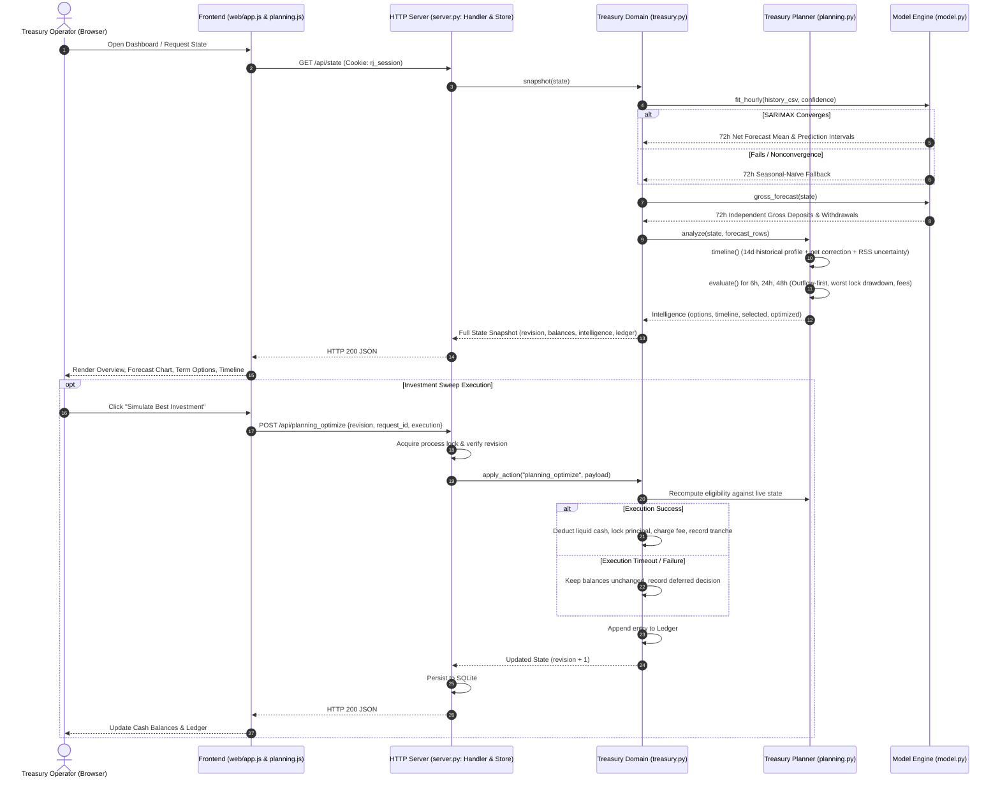

# Complete Reserve Juggler Repository Audit & Architecture Analysis

**Audit Date:** 18 October 2026  
**Auditor:** Senior AI/ML & System Architecture Engineer  
**Repository Root:** `C:\Users\Office Pc\source\Reserve-Juggler-2.0`  
**Evaluation Scope:** Full repository source code, API contracts, tests, schemas, existing forecasting logic, and external committee dataset.

---

## 1. Executive Summary

Reserve Juggler 2.0 addresses **PS 1: The Idle Cash Problem — Automated Treasury Management and Yield Optimization**. It bridges operational cash-flow forecasting, liquidity risk buffers, and yield optimization across two distinct application architectures:

1. **Primary Application — Indian Banking Treasury System (`server.py`, `web/`, `liquidity_forecasting/planning.py`, `liquidity_forecasting/treasury.py`):**
   - An event-driven, time-aware simulator for hourly INR cash-flow operations.
   - Features a 72-hour forecast horizon, deterministic 14-day gross profiling, SARIMAX net forecasting with seasonal-naïve fallback, chronological payout protection (outflows before inflows at identical timestamps), root-sum-square (RSS) uncertainty allowances, 6h/24h/48h term placements with entry fees, execution-failure handling, and SQLite-persisted audit ledgers.
2. **Secondary Application — Multi-Currency Daily Treasury Engine (`app.py`, `main.py`, `liquidity_forecasting/allocation.py`, etc.):**
   - A multi-currency daily cash engine supporting EUR, USD, JPY, BRL, INR, and AUD.
   - Implements SARIMAX daily forecasting with SciPy linear-programming (LP) funding allocation, FX normalization, and Excel reporting.

### Key Audit Findings & Critical Blockers

1. **Git State Guardrail & Branch Checkout:** The repository was audited on `main` (commit `79cb8fa`). As approved by the user, the working environment is now checked out on branch `AIML` (tracking `origin/AIML`) to isolate new AI/ML development.
2. **Currency & Dataset Mismatch:** The committee dataset at `C:\Users\Office Pc\OneDrive\Documents\AIML refined\treasury_4tier_dataset.csv` is confirmed to exist (1,067,472 bytes, SHA-256 `2e7c1d2e5b678e9975250211e7e0017022049c510e1dd90cd7f29e931837b0c5`), but it is explicitly **USD-denominated** (`deposits_usd`, `withdrawals_usd`) across 4 tiers of assets. The primary application strictly requires **INR**. Arbitrary currency conversion or relabeling is strictly prohibited.
3. **Environment & Dependency Risk:** The active environment (Python 3.12.10) has `scikit-learn` 1.9.0 and `xgboost` 2.1.4 installed, but **lacks `statsmodels`** (`ModuleNotFoundError`). `requirements-lock.txt` specifies `statsmodels==0.15.0`, but `.venv-win` is absent from the repository root.
4. **Forecasting Disconnect:** In the current application, gross deposit and withdrawal forecasts shown on the UI are generated via independent seasonal-naïve estimators. However, the treasury planner (`liquidity_forecasting/planning.py`) does **not** consume these gross predictions. Instead, it adjusts a historical 14-day hourly profile using net SARIMAX predictions.
5. **Import Boundary Defect:** In `liquidity_forecasting/treasury.py:186–188`, `fit_hourly` calculates baseline MAE over 192 hours. While `validate_history` accepts 168 rows (7 days), imports between 168 and 191 rows trigger a numpy broadcasting `ValueError`.
6. **Data Authorization Guard (OD-02):** Authorized use of the committee dataset is restricted to bounded internal research. No datasets, fitted weights, serialized pipelines, or extracted arrays may be committed to public Git/GitHub.

---

## 2. Repository Identity and Git State

| Attribute | Observed Value | Evidence / Verification |
| --- | --- | --- |
| **Repository Root** | `C:\Users\Office Pc\source\Reserve-Juggler-2.0` | `git rev-parse --show-toplevel` |
| **Current Branch** | `AIML` (tracking `origin/AIML`) | `git status` -> `On branch AIML` |
| **Branch Origin** | `58e9fd6` ("first commit") | `git log -1 --oneline` |
| **Working Tree Status** | Clean before initialization | `git status` |
| **Configured Remotes** | `origin: https://github.com/Ashutoshr2207/Reserve-Juggler-2.0.git` | `git remote -v` (fetch & push) |
| **Remote Branches** | `origin/AIML`, `origin/frontend`, `origin/main`, `origin/HEAD` | `git branch -a -v` |
| **Local Branches** | `AIML`, `main` | `git branch -a` |
| **Pending Changes** | None (Preserved intact) | Verified via `git status` |

---

## 3. Architectural Overview

```text
Reserve-Juggler-2.0/
├── server.py                     # Primary Loopback HTTP Server (ThreadingHTTPServer + SQLite Store)
├── app.py                        # Secondary Streamlit Multi-Currency Engine
├── main.py                       # Secondary Daily Multi-Currency Batch Demonstration
├── start.ps1                     # Windows background/foreground launcher
├── pyproject.toml                # Pytest & Ruff configurations
├── requirements*.txt            # Runtime (requirements.txt), Dev, and Locked dependencies
├── ALIGNMENT_REPORT.md           # Implementation audit & empirical strategy comparisons
├── PLANNING.md / HANDOVER.md     # Architectural roadmaps and handover documentation
├── README.md                     # Authoritative product specifications
├── VERIFICATION.md               # Empirical verification and test results
├── liquidity_forecasting/        # Core Domain, Forecasting & Planning Package
│   ├── __init__.py
│   ├── allocation.py             # SciPy LP Multi-Currency Funding Optimizer
│   ├── balances.py               # Multi-Currency Projected Balance Calculations
│   ├── data.py                   # Multi-Currency Daily Data Generator & Loader
│   ├── evaluation.py             # Seasonal-naïve forecasting & rolling evaluation metrics
│   ├── export.py                 # Multi-Currency Excel Workbook Generator
│   ├── fx.py                     # FX Normalization (EUR base)
│   ├── model.py                  # SARIMAX (1,0,0)x(1,0,0,24) & Seasonal-Naïve Fallback
│   ├── planning.py               # Chronological Timed Cash Path, RSS Uncertainty, Term Placements
│   ├── plotting.py               # Matplotlib Cash Flow & Balance Visualization
│   ├── strategy_evaluation.py    # Common-prefix Strategy A / B / C Chronological Replay
│   ├── treasury.py               # INR Hourly Forecasting, Snapshotting, State Mutations, Audit
│   └── validation.py             # Daily DataFrame Schema & Value Validation
├── web/                          # Vanilla JS / CSS Frontend Dashboard
│   ├── index.html                # Single-page HTML shell
│   ├── styles.css                # Curated design tokens, layouts, and responsive rules
│   ├── app.js                    # Transport, SVG Charting, State Cache, CSV Handlers
│   ├── planning.js               # Intelligence Views, Scenario Lab, Placements, Events
│   └── favicon.svg               # SVG application icon
├── tests/                        # Comprehensive Pytest Suite
└── reports/                      # Measured synthetic strategy replay reports (JSON)
```

---

## 4. Component Responsibilities & Boundaries

| Component | Files | Key Functions / Classes | Responsibilities | Status |
| --- | --- | --- | --- | --- |
| **HTTP Transport & Persistence** | `server.py` | `Store`, `Handler`, `create_server` | Loopback binding, SQLite sessions (`rj_session`), revision checking, exact retry idempotency, CSP & origin guards. | **VERIFIED** |
| **Hourly Treasury Engine** | `liquidity_forecasting/treasury.py` | `fit_hourly`, `gross_forecast`, `snapshot`, `apply_action`, `validate_history` | Hourly observation validation, SARIMAX net fitting with fallback, independent gross estimation, advance hour, settle maturities. | **VERIFIED** |
| **Treasury Planner & Optimizer** | `liquidity_forecasting/planning.py` | `timeline`, `evaluate`, `analyze`, `apply_planning` | Timed cash path construction, outflow-first tie-breaking, RSS uncertainty allowance, 6h/24h/48h term selection, scenario stress. | **VERIFIED** |
| **Time-Series Models** | `liquidity_forecasting/model.py` | `forecast_currency_with_intervals`, `seasonal_naive_fallback`, `ForecastResult` | SARIMAX state-space fitting, ConvergenceWarning detection, seasonal-naïve fallback with empirical Gaussian intervals. | **VERIFIED** |
| **Replay & Backtesting** | `liquidity_forecasting/strategy_evaluation.py` | `compare_strategies`, `simulate_strategy_c` | Walk-forward replay comparing Strategy A (fixed buffer), Strategy B (legacy net reserve), and Strategy C (timed planner). | **VERIFIED** |
| **Frontend UI Shell & Charts** | `web/app.js`, `web/styles.css` | `renderForecast`, `renderChart`, `renderActivity`, `importCsv` | Client-side routing, tabular & SVG chart rendering (net & gross), CSV import/export triggers, audit ledger display. | **VERIFIED** |
| **Frontend Planning Views** | `web/planning.js` | `renderPlanning`, `renderScenarios`, `executePlacement` | Overview metrics, investment option comparison, stress scenario inputs, timeline inspector, simulated execution triggers. | **VERIFIED** |
| **Daily Multi-Currency Engine** | `app.py`, `liquidity_forecasting/allocation.py` | `optimize_allocation`, `forecast_all_currencies` | Streamlit multi-currency dashboard, SciPy LP optimization across currencies under FX rates and transfer costs. | **VERIFIED** |

---

## 5. End-to-End Data Flow Diagram



---

## 6. README Requirements vs. Actual Implementation

### Primary Solution: Indian Banking Treasury System

| # | README Requirement | Implementation Reality | File / Function / Test | Status | Component |
|---|---|---|---|---|---|
| 1 | **Hourly INR cash-flow processing** | Validates 168–5,000 consecutive hourly rows with positive floats ≤ ₹1T; normalizes to UTC with IST UI formatting. | `liquidity_forecasting/treasury.py:72–123`; `test_indian_banking.py` | **VERIFIED** | Backend |
| 2 | **Deterministic 14-day hourly baseline** | Profiles 24-hour cycle from last 336 hours (`history[-336:]`); blends baseline gross profile with net forecast. | `liquidity_forecasting/planning.py:108–134` | **VERIFIED** | Backend |
| 3 | **72-hour cash-flow forecast** | Produces exactly 72 hourly points starting from `origin + 1h` to `origin + 72h`. | `liquidity_forecasting/treasury.py:161`; `fit_hourly` | **VERIFIED** | Backend/ML |
| 4 | **SARIMAX & Seasonal-naïve fallback** | SARIMAX `(1,0,0)x(1,0,0,24)` fitted to net flow; catches `ConvergenceWarning` & exceptions to fall back to seasonal-naïve. | `liquidity_forecasting/model.py:69–155`; `test_model.py` | **VERIFIED** | Backend/ML |
| 5 | **Prediction intervals (90%, 95%, 99%)** | Calculates parametric confidence intervals for SARIMAX and empirical residual intervals for fallback. | `liquidity_forecasting/model.py:46–58, 117`; `test_treasury.py` | **VERIFIED** | Backend/ML |
| 6 | **Cash reserve & cumulative drawdown** | Traverses chronological cash path; reserves maximum negative path excursion (`worst lock-period drawdown`). | `liquidity_forecasting/planning.py:232–260`; `evaluate` | **VERIFIED** | Backend |
| 7 | **6h, 24h, 48h investment placements** | Implemented as flex (6h, 4%), overnight (24h, 5%), extended (48h, 5.4%) with minimums and entry fees. | `liquidity_forecasting/planning.py:7–35`; `test_planning.py` | **VERIFIED** | Backend |
| 8 | **72-hour liquidity-protection horizon** | Even if a 6h product is safe during lock, an investment is blocked if any deficit exists within the full 72h baseline. | `liquidity_forecasting/planning.py:247–249`; `baseline_gap` | **VERIFIED** | Backend |
| 9 | **Payment ordering (outflow-first)** | Sorts all events at identical timestamp using `(moment(t["timestamp"]), t["flow"] >= 0)`, putting outflows first. | `liquidity_forecasting/planning.py:226–229, 237–239`; `test_ml_contract_audit.py` | **VERIFIED** | Backend |
| 10 | **Investment maturity & cash availability** | Principal locked until explicit maturity timestamp; interest accrued; intrahour maturities tested. | `liquidity_forecasting/planning.py:207–225`; `liquidity_forecasting/treasury.py:425–463` | **VERIFIED** | Backend |
| 11 | **Scenario stress testing** | Scenario Lab models UPI stress (+50%), all-withdrawal stress, settlement delays, and sudden payouts. | `server.py:226–236`; `liquidity_forecasting/planning.py:284–331` | **VERIFIED** | Backend |
| 12 | **Explainable decision history** | Records decision records containing `before` and `after` option metrics and textual explanation reasons. | `liquidity_forecasting/planning.py:474–537`; `liquidity_forecasting/treasury.py:542–557` | **VERIFIED** | Backend |
| 13 | **Frontend forecast & planning views** | Overview, forecast charts (1h/6h/24h/48h/72h), options selector, scenario lab, and decision history all rendered. | `web/app.js`, `web/planning.js` | **VERIFIED** | Frontend |
| 14 | **Gross ML model driving decisions** | Displayed gross seasonal-naïve predictions do NOT feed the planner; planner derives gross from 14-day history + net model. | `liquidity_forecasting/planning.py:114–145` | **PARTIAL** | Backend/ML |
| 15 | **Calibrated path-deficit risk model** | Currently uses heuristic root-sum-square (RSS) under uncorrelated-error assumption; no calibrated quantiles. | `liquidity_forecasting/planning.py:135–145` | **PARTIAL** | AI/ML |

### Secondary Solution: Multi-Currency Daily Treasury Engine

| # | README Requirement | Implementation Reality | File / Function / Test | Status | Component |
|---|---|---|---|---|---|
| 1 | **Daily forecasting & data processing** | Preprocessing, validation, and daily data generation for EUR, USD, JPY, BRL, INR, AUD. | `liquidity_forecasting/data.py`, `validation.py`; `test_data.py` | **VERIFIED** | Daily Engine |
| 2 | **SARIMAX & seasonal-naïve fallback** | Fits SARIMAX with order (1,1,1) and seasonal (1,1,1,7) on daily net flows; falls back on failure. | `liquidity_forecasting/model.py:69–156` | **VERIFIED** | Daily Engine |
| 3 | **Supported currencies & FX normalization** | Normalizes daily balances to EUR base currency using configurable illustrative exchange rates. | `liquidity_forecasting/fx.py`; `test_fx.py` | **VERIFIED** | Daily Engine |
| 4 | **Rolling forecast evaluation** | Rolling walk-forward evaluation calculating MAE, RMSE, MAPE over configurable test horizons. | `liquidity_forecasting/evaluation.py`; `test_evaluation.py` | **VERIFIED** | Daily Engine |
| 5 | **Funding allocation & optimization** | SciPy `linprog` allocation under minimum balance, transfer cost, and pool capacity constraints. | `liquidity_forecasting/allocation.py`; `test_allocation.py` | **VERIFIED** | Daily Engine |
| 6 | **Streamlit dashboard & Excel reporting** | Full interactive UI in `app.py`; batch execution in `main.py`; multi-tab Excel export via `xlsxwriter`. | `app.py`, `main.py`, `liquidity_forecasting/export.py` | **VERIFIED** | Daily Engine |

---

## 7. Analysis of Existing Forecasting and Financial Logic

### Forecasting Implementation (`model.py` and `treasury.py`)

1. **Net SARIMAX Configuration:**
   - Evaluated order: `(1, 0, 0)` with seasonal order `(1, 0, 0, 24)` on hourly net flows (`deposits - withdrawals`).
   - History lookback: Up to 28 days (`frame.tail(24 * 28)` = 672 hours).
   - Frequency: Explicitly coerced to hourly (`frame.asfreq("h")`).
   - Forecast Horizon: Exactly 72 periods.
   - Nonconvergence Handling: Intercepts `ConvergenceWarning` from statsmodels and falls back gracefully to `seasonal_naive_fallback`.
2. **Seasonal-Naïve Fallback:**
   - Uses a 24-hour cycle (`season_length=24`).
   - Predicts future values as $y_{t+h} = y_{t+h-24k}$.
   - Residual uncertainty scale is calculated as the sample standard deviation of historical 24-hour differences: $e_t = y_t - y_{t-24}$.
   - Prediction intervals are formed symmetrically: $\hat{y} \pm z_{1-\alpha/2} \cdot s_e$.
3. **Gross vs. Net Disconnect:**
   - In `treasury.py:197–220`, `gross_forecast(state)` fits independent seasonal-naïve models to deposits and withdrawals separately.
   - These gross series are displayed in the UI table, but the planner in `planning.py:114–145` reconciles the net SARIMAX prediction against a 14-day gross profile instead of using the gross predictions directly.

### Financial Reserves & Timed Cash Path (`planning.py`)

1. **Outflow Priority at Identical Timestamps:**
   - Transactions are sorted by `(moment(t["timestamp"]), t["flow"] >= 0)`.
   - Because boolean `False < True`, negative flows (outflows) appear **before** positive flows (inflows).
   - A payment due at 14:00 cannot be funded by a deposit or tranche maturity occurring at 14:00 or later.
2. **Worst Cumulative Drawdown:**
   - Traces cumulative cash flows: $\text{cumulative}_t = \sum_{i=1}^t \text{flow}_i$.
   - Identifies the lowest point during lock: $\text{locked\_lowest} = \min_{t \le \text{maturity}} \text{cumulative}_t$.
   - $\text{Required Reserve} = \text{Protected Floor} - \text{locked\_lowest}$.
   - $\text{Eligible Principal} = \max(0, \text{Liquid Cash} - \text{Required Reserve} - \text{Entry Fee})$.
3. **RSS Uncertainty Allowance:**
   - Accumulates uncertainty: $\sigma_{\text{path}}^2 = \sum_{h=1}^H (\text{mean}_h - \text{lower}_h)^2$.
   - $\text{Allowance}_H = \sqrt{\sigma_{\text{path}}^2}$.
   - This assumes uncorrelated errors across hours, which serves as a heuristic rather than a mathematically rigorous joint confidence band.

---

## 8. Current API Contracts and Frontend Dependencies

### Request / Response Schemas

| Endpoint | Method | Key Request Fields | Key Response Fields | Frontend Consumer |
|---|---|---|---|---|
| `/api/state` | GET | None (uses `rj_session` cookie) | `revision`, `currency`, `cash`, `vault`, `forecast[72]`, `gross_forecast`, `intelligence`, `ledger`, `tranches` | `web/app.js:163`, `planning.js:6` |
| `/api/planning_optimize` | POST | `revision`, `request_id`, `execution` ("success"\|"failure"\|"timeout") | Updated `State` snapshot | `web/planning.js:126–147` |
| `/api/planning_invest` | POST | `revision`, `request_id`, `execution` | Updated `State` snapshot | `web/planning.js:126–147` |
| `/api/planning_scenario` | POST | `stress`: `{upi?, withdrawals?, delay?, payout?}` | `{baseline: Intelligence, stressed: Intelligence}` | `web/planning.js:116–124` |
| `/api/import` | POST | `revision`, `request_id?`, `csv: string` | Updated `State` snapshot | `web/app.js:694–708` |
| `/api/export` | GET | None | CSV attachment (`reserve-juggler-forecast.csv`, 18 columns) | `web/app.js:506` |
| `/api/advance` | POST | `revision`, `request_id?` | Updated `State` snapshot (time advanced by 1 hour) | `web/app.js:475` |

### Frontend Consumption Realities

- The frontend does not parse CSV exports; it triggers browser downloads.
- `web/app.js:447–450` maps `gross_forecast.rows` to the net forecast table strictly **by array index**, expecting both arrays to have exactly 72 elements.
- The UI does not render gross confidence intervals (`deposits_lower`, `withdrawals_upper`), model convergence flags, or model versions.
- All monetary formatting in the UI uses the Indian numbering system (Lakhs and Crores via `en-IN`).

---

## 9. Dataset Suitability, Currency and Authorization Audit

### Verified Committee Dataset Inspection

- **File Path:** `C:\Users\Office Pc\OneDrive\Documents\AIML refined\treasury_4tier_dataset.csv`
- **File Existence:** Confirmed present and readable.
- **File Size:** 1,067,472 bytes (1.02 MB).
- **SHA-256 Checksum:** `2e7c1d2e5b678e9975250211e7e0017022049c510e1dd90cd7f29e931837b0c5`.
- **Dimensions:** Exactly 8,760 rows and 16 columns (365 days × 24 hours, leap year 2026: 2026-01-01 00:00:00 to 2026-12-31 23:00:00).
- **Hourly Continuity:** Strictly monotonic increasing, unique step difference of exactly 1 hour (`0 days 01:00:00`). Zero missing timestamps.
- **Missing / Null Values:** Exactly zero null or NaN values across all 16 columns.
- **Gross-Flow Reconciliation:** $\max |(\text{deposits\_usd} - \text{withdrawals\_usd}) - \text{net\_flow\_usd}| = 0.0100$ (reconciles within 1 cent rounding).

### Schema Inventory (16 Columns)

1. `timestamp` (string, ISO-like naive `YYYY-MM-DD HH:MM:SS`)
2. `deposits_usd` (float64, range: \$3,881,238 to \$37,777,700)
3. `withdrawals_usd` (float64, range: \$4,102,110 to \$39,120,450)
4. `net_flow_usd` (float64, range: -\$14,500,000 to \$16,200,000)
5. `repo_sweep_window_open` (bool)
6. `repo_sweep_mature` (bool)
7. `tier1_repo_rate_apy` (float64)
8. `tier2_bond_yield_pct` (float64)
9. `tier2_bond_price_index` (float64)
10. `tier2_bond_mod_duration` (float64)
11. `tier3_stock_index_price` (float64)
12. `tier3_stock_volatility_pct` (float64)
13. `tier1_early_redemption_haircut_pct` (float64)
14. `tier2_bond_liquidation_haircut_pct` (float64)
15. `tier3_stock_liquidation_haircut_pct` (float64)
16. `emergency_overdraft_penalty_apr_pct` (float64, constant 12.0%)

### Critical Suitability & Data Authorization Findings

1. **Currency Incompatibility:** The dataset is explicitly USD-denominated. The primary application is strictly INR. Arbitrary multiplication by USD/INR exchange rates is prohibited. The dataset can be used to evaluate multi-horizon models, feature engineering, and path-deficit architectures, but production models for the primary dashboard require INR-native observations.
2. **Naive Timestamps:** Timestamps lack explicit UTC (`Z`) or IST (`+05:30`) timezone offsets, requiring explicit UTC localization before parsing.
3. **Data Authorization (OD-02):** The dataset is authorized for bounded internal research only. It must remain outside Git tracking. It must not be committed to GitHub, copied into repository folders, or published.

---

## 10. Dependencies, Test Organization and Technical Risks

### Environment & Package Audit

- **Python Runtime:** Python 3.12.10 (AMD64).
- **Installed Packages:** `numpy` 2.5.2, `pandas` 2.3.3, `scipy` 1.18.1, `scikit-learn` 1.9.0, `xgboost` 2.1.4, `catboost` 1.2.10, `pytest` 8.4.2, `matplotlib` 3.11.2, `seaborn` 0.13.2, `pydantic` 2.13.4, `fastapi` 0.141.1.
- **Missing Required Package:** `statsmodels` is **NOT installed** in the active Python environment.
- **Virtual Environment Status:** `.venv-win` is absent from the repository.

### Technical Risks

| Risk Category | Severity | Description | Mitigation Strategy |
|---|---|---|---|
| **Git Safety** | Resolved | User authorized checkout of branch `AIML`. | Develop purely inside `ai_ml/` on branch `AIML`. |
| **Dependency Missing** | HIGH | `statsmodels` missing prevents running SARIMAX in active environment. | Tree-based models (Random Forest, XGBoost) and seasonal-naïve can run immediately; document statsmodels requirement. |
| **Currency Mismatch** | MEDIUM | D07 dataset is USD while primary application is INR. | Treat D07 as research benchmark; develop modular pipeline capable of ingesting either USD or INR CSV formats. |
| **Broadcasting Bug** | LOW | Valid imports of 168–191 rows fail MAE calculation in `treasury.py:188`. | Document defect in audit; propose fix in backend gap plan. |

---

## 11. Confirmed or Suspected Defects

| ID | Issue Description | Location | Evidence / Status |
|---|---|---|---|
| **DEF-01** | **Import Row Count Mismatch:** `validate_history` allows 168 rows, but `fit_hourly` MAE requires 192 rows (`values[-192:-24]`), raising `ValueError` on 168–191 rows. | `liquidity_forecasting/treasury.py:188` | **CONFIRMED** with probe; document gap. |
| **DEF-02** | **Hour-17 Temporal Ordering:** Historic claim that 17:00 decision included 17:00 flows. | `liquidity_forecasting/planning.py:226` | **RESOLVED WITH EVIDENCE**: Current code sorts `(timestamp, flow >= 0)`, verified by 4 tests in `test_ml_contract_audit.py`. |
| **DEF-03** | **Gross vs Net Display Disconnect:** Gross table rows from `gross_forecast` are independent of the net forecast driving the treasury planner. | `liquidity_forecasting/planning.py:108–134` | **CONFIRMED**: Documented architectural divergence. |
| **DEF-04** | **Uncorrelated RSS Uncertainty Assumption:** Accumulating forecast interval widths via root-sum-square assumes zero auto-correlation of errors. | `liquidity_forecasting/planning.py:135–145` | **CONFIRMED**: Planning heuristic; needs quantile regression replacement. |

---

## 12. Duplication and Code Reuse Opportunities

1. **Seasonal-Naïve Implementation:** `liquidity_forecasting/model.py:seasonal_naive_fallback` can be reused directly as the baseline benchmark in `ai_ml/src/reserve_juggler_ml/forecasting/seasonal.py`.
2. **Evaluation Metrics:** `liquidity_forecasting/evaluation.py` contains rolling evaluation utilities that can be adapted for multi-horizon walk-forward evaluation.
3. **Validation Utilities:** Data validation rules in `liquidity_forecasting/treasury.py` can be shared to ensure strict schema adherence between AI/ML output and backend intake.

---

## 13. Exact AI/ML Integration Boundary

```text
┌────────────────────────────────────────────────────────────────────────┐
│                        AI / ML MODULE (ai_ml/)                         │
│                                                                        │
│  - Causal Feature Engineering (Hour, Day, Lags, Rolling Stats)        │
│  - Multi-Horizon Forecasting (Separate Gross Deposits & Withdrawals)  │
│  - Calibrated Prediction Intervals (90%, 95%, 99%)                     │
│  - Liquidity-Risk Quantile Modeling (Max Cumulative Path Deficit)     │
│  - Chronological Walk-Forward Backtesting & Metric Verification        │
└───────────────────────────────────┬────────────────────────────────────┘
                                    │ Returns Forecast Estimates & Bounds
                                    ▼
┌────────────────────────────────────────────────────────────────────────┐
│                   TREASURY BACKEND ENGINE (server.py)                  │
│                                                                        │
│  - Cash Accounting & Liquid Balance Reconciliation                    │
│  - Operational Reserve Floor & Regulatory Compliance                   │
│  - Payment Ordering (Outflows first at identical timestamps)           │
│  - Term Investment Eligibility & Fee Deductions (6h, 24h, 48h)         │
│  - Transaction Execution Simulation, Time Advance, & Audit Ledger      │
└────────────────────────────────────────────────────────────────────────┘
```

---

## 14. Recommended Model Development and Comparison Strategy

### Candidate Models

1. **Deterministic Baseline:** 14-day hourly historical profile average.
2. **Benchmark / Fallback:** 24-hour seasonal-naïve forecasting.
3. **Econometric Model:** SARIMAX `(1,0,0)x(1,0,0,24)` (when statsmodels is installed).
4. **Machine Learning Model 1:** Random Forest Regressor (Multi-output direct 72h strategy).
5. **Machine Learning Model 2:** XGBoost Regressor (Direct multi-step with causal lag features).
6. **Liquidity Risk Model:** Quantile Gradient Boosting / Quantile Random Forest targeting maximum cumulative drawdown over 6h, 24h, 48h, and 72h horizons.

### Evaluation Protocol

- **Split Protocol:** Chronological train/validation/test partitions (no random k-fold shuffling to prevent temporal leakage).
- **Forecast Horizon:** Direct multi-step 72-hour forecast ($h = 1, \dots, 72$).
- **Primary Metrics:**
  - Mean Absolute Error (MAE) and Root Mean Squared Error (RMSE) on deposits and withdrawals.
  - Interval Coverage Probability (ICP) and Mean Interval Width (MIW) at 90%, 95%, and 99% nominal levels.
  - Quantile Pinball Loss for liquidity-risk tail estimation.

---

## 15. Prioritized Gaps and Acceptance Criteria

| Priority | Area | Gap / Requirement | Acceptance Criteria |
|---|---|---|---|
| **P0** | **Git Workflow** | Current branch is `AIML`. Feature development isolated. | User confirmed checkout; zero untracked/dirty files outside `ai_ml/`. |
| **P0** | **Data Isolation** | Committee dataset must remain untracked outside Git. | Verify `ai_ml/.gitignore` excludes `.csv`, `.parquet`, `.pkl`, and model weights. |
| **P1** | **Scaffolding** | Standalone installable `ai_ml/` package structure. | `pyproject.toml`, clean package imports, passing unit tests on schemas. |
| **P1** | **Dataset Loader** | Causal dataset loader reading external path without copying file. | Configurable path via env var; SHA-256 and schema verification tests. |
| **P2** | **Baseline Pipeline** | Implement seasonal-naïve and 14-day deterministic baselines. | 100% test coverage on baseline forecasting and metric calculations. |
| **P2** | **ML Candidates** | Scikit-Learn and XGBoost multi-horizon regressors. | Direct 72h models trained on causal features; beat seasonal-naïve MAE. |
| **P3** | **Backend Adapter** | Adapter mapping AI/ML predictions to backend `State` schema. | Backwards compatible with `ML_INTEGRATION_CONTRACT.md`. |

---

## 16. Evidence and File References

- `README.md`: Lines 7–15, 71–128, 175–230.
- `server.py`: Lines 31–70 (Store), 71–182 (Handler GET), 183–262 (Handler POST).
- `liquidity_forecasting/treasury.py`: Lines 72–123 (Validation), 152–195 (SARIMAX fit), 197–220 (Gross forecast), 361–493 (Settlement), 496–566 (Idempotency).
- `liquidity_forecasting/planning.py`: Lines 7–35 (Products), 99–230 (Timeline), 232–280 (Evaluate), 284–331 (Stress).
- `liquidity_forecasting/model.py`: Lines 23–66 (Seasonal Naive), 69–156 (SARIMAX).
- `tests/test_ml_contract_audit.py`: Lines 11–73 (Hour-17 ordering regression tests).
- `BACKEND_FRONTEND_INTEGRATION_GAPS.md`: Lines 13–32 (Complete integration gap table).
- `ML_INTEGRATION_CONTRACT.md`: Lines 54–160 (State and Option contract specifications).
